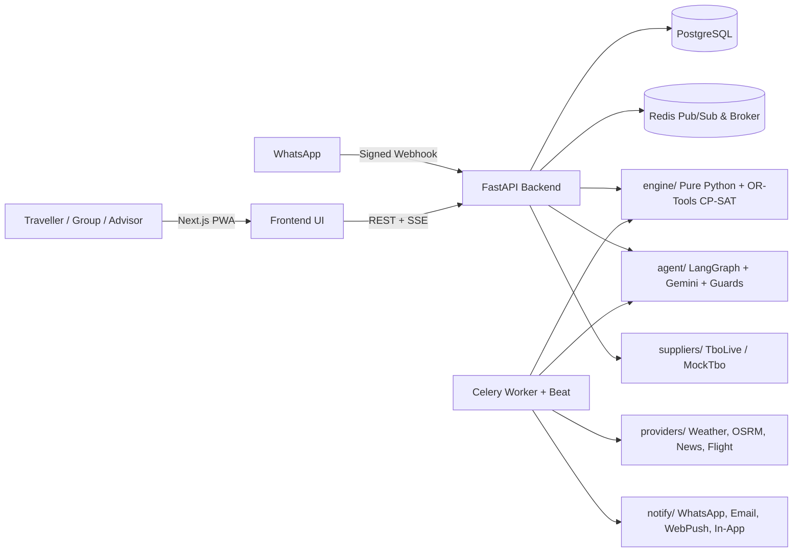

# WAYFINDER ONE — Architecture

**Core Principle:** *LLM reasons, solver certifies, supplier layer books, traveller approves every consequential action.*

## 1. High-Level System Architecture



## 2. Pure Engine & Mathematical Model (`engine/`)

All modules under `engine/` are **pure, deterministic Python libraries** with zero DB, network, or wall-clock access (`now` is explicitly passed in; CP-SAT runs with `num_workers=1`, `random_seed=7`, `max_time_in_seconds=5.0`).

### 2.1 Probabilistic Feasibility & Independence Assumption
- Hard links connect every `fixed` or `hard_deadline` item to its upstream chain (e.g. `it_a_f1 → it_a_t1 → it_a_e1`, `it_a_t1 → it_a_h1`, `it_a_t2 → it_a_f2`).
- `scheduled_slack = deadline − (predecessor_end + overhead)` (`20` min gate overhead; `115` min airport check-in overhead).
- `effective_slack = scheduled_slack − μ`, where `μ` sums upstream flight/traffic delays (absorbed by any excess airport padding beyond `45` min), weather uplifts (`+15` min MODERATE, `+30` min HEAVY on `GHAT_ROAD`/`RAIN`), and bandh uplifts (`+60` min).
- **Independence Assumption:** Leg duration perturbations are modeled as independent normal random variables with standard deviations (`FLIGHT=25`, `TRANSFER=20`, `GHAT_TRANSFER=30`, `ACTIVITY=10`, `HOTEL=10` min), giving `σ_link = sqrt(Σ σ_leg²)` and `P_link = Φ(effective_slack / σ_link)`.
- `feasibility = Π P_link × budget_fit × constraint_sat`.

### 2.2 Slack Score (0–100)
`score = 0.40·time_buffer + 0.25·delay_risk + 0.15·weather_risk + 0.10·crowd_risk + 0.10·budget_headroom`.
Health bands: **GREEN ≥ 75**, **AMBER 45–74**, **RED < 45**.

### 2.3 Switch Engine (FULL vs MIXED)
Triggered when `min_effective_slack < 20` min or `feasibility(A) < feasibility(B) − 0.10`.
Evaluates `FULL` (Plan B) and `MIXED` (replaces only failing links & colliding day segments while preserving unaffected days and committed flights/hotels). Selects the candidate with `feasibility ≥ 0.90` that minimizes lost item priority value (`MUST=5`, `NICE=2`, `SKIP_IF_NEEDED=1`), then incremental cost.

### 2.4 Twin Plans, Time Banking, Optionality, Group & Responsible Layers
- **Plan B:** Preserves flights/hotels, shifts arrival transfers ≥ 90 min later, avoids outdoor `RAIN`-tagged items, and rewards refundable offers.
- **Time Banking (`timebank.rebalance`):** Protects `MUST` items, shortens non-fixed dwell up to 25%, drops `SKIP_IF_NEEDED` then lowest-value `NICE`.
- **Optionality (`optionality.report`):** Recommends `FLEX` iff `expected_loss_saver > flex_premium_inr`.
- **Group (`group.py`):** Minimum per-person budget, union of hard constraints, most conservative pace, majority + owner-tiebreak votes, and exact largest-remainder rupee cost splitting (`EQUAL` and `BY_BUDGET`).
- **Responsible (`responsible.py`):** Computes illustrative carbon footprint using `EMISSION_FACTORS_V1` in [`engine/config.py`](file:///home/ronit/1PROJECTS/wayfinder/wayfinder-one/engine/config.py) and pairs high-impact items with inventory alternatives.

## 3. Agentic Pipeline & Guardrails (`agent/`)

```
router ─ PLAN ─▶ extract ─▶ merge_intent ─▶ [missing?] ─▶ clarify (≤2 questions) ─▶ END
                                         └▶ [no dest?] ─▶ recommend (3 options)  ─▶ END
                                         └▶ [ready]    ─▶ plan (CP-SAT) ─▶ explain ─▶ END
       ─ TRIP_QA ─▶ qa (answers strictly from AgentState.trip_facts) ─▶ END
       ─ CANCEL  ─▶ propose_cancel (proposed_action=CANCEL_BOOKING) ─▶ END
```

- **Fact Guard (`agent/guards.py`):** Every currency amount (`₹`), percentage (`%`), duration (`min`), and clock time (`HH:MM`) produced by Gemini must exist verbatim in structured facts; any mismatch discards the LLM text and reverts to a deterministic [`agent/i18n.py`](file:///home/ronit/1PROJECTS/wayfinder/wayfinder-one/agent/i18n.py) template.
- **Fallback:** `LLM_MODE=mock` by default; Gemini enforces an 8-second timeout and automatically falls back to `mock_llm` (`llm_fallback=True`) with zero user-facing errors.

## 4. Real vs Mock Matrix

| Component | Real Mode | Default / Offline Safe Mode |
|---|---|---|
| OR-Tools CP-SAT, Slack, Switch, Timebank, Group, Optionality, Responsible, Evidence | **Real** | **Real** |
| LangGraph + Guardrails + Local Pulse Rules + i18n | **Real** (Gemini with 8s timeout) | Deterministic `LLM_MODE=mock` fallback |
| Supplier Inventory & Booking | `TboLiveAdapter` (`SUPPLIER=tbo_live\|hybrid`) | `MockTboAdapter` (`SUPPLIER=mock`) |
| Weather & Routing | Open-Meteo & OSRM (`SIGNAL_SOURCE=live\|hybrid`) | Seeded/simulated (`SIGNAL_SOURCE=sim`) |
| Notifications (WhatsApp / Email / Push) | Meta/Twilio, SMTP, VAPID (`NOTIFY_MODE=live`) | Outbox simulator (`NOTIFY_MODE=sim`) |
| Maps | MapLibre GL + self-hosted PMTiles (`make maps`) | Offline regional PMTiles / SVG fallback |
